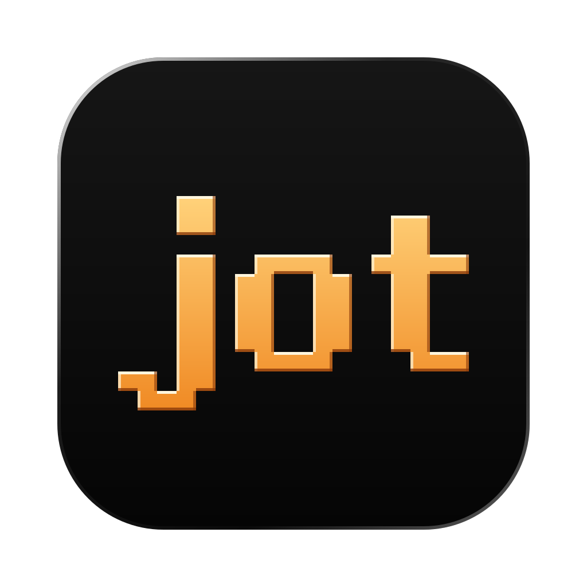
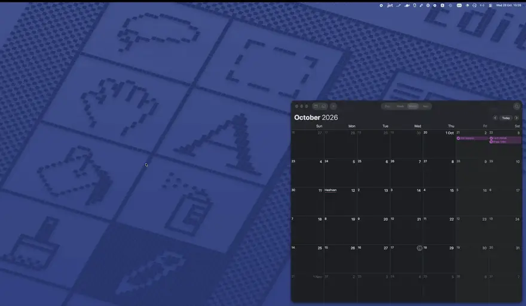
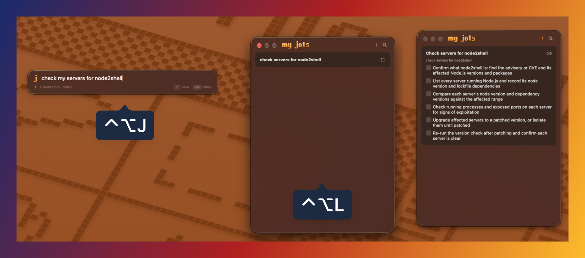
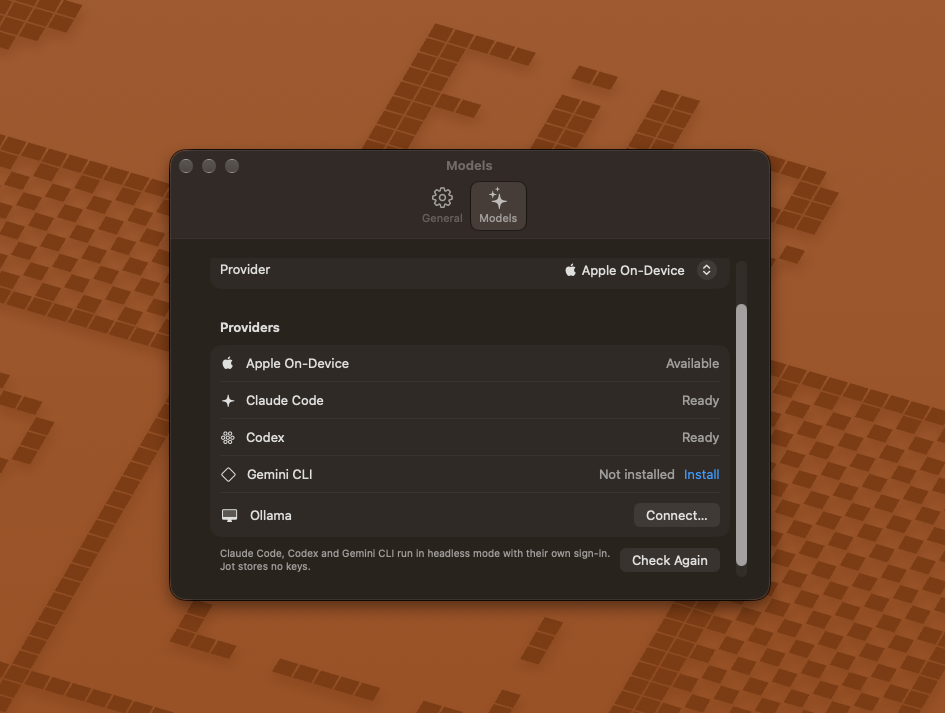

<p align="center">
  
</p>

<p align="center">
  <b>No bad time for an idea. No more lost notes.</b><br>
  A native macOS menu bar app that turns a quick note into an AI checklist on your desktop.
</p>

<p align="center">
  <a href="LICENSE"></a>
  
  
  
  
</p>

<p align="center">
  <a href="#what-it-does">What it does</a> ·
  <a href="#how-it-works">How it works</a> ·
  <a href="#build-from-source">Build</a> ·
  <a href="#privacy">Privacy</a> ·
  <a href="#why-not-apple-notes-drafts-or-a-chat-app">Why not…?</a> ·
  <a href="#faq">FAQ</a>
</p>

<p align="center">
  
  <br><sub>⌃⌥J captures, ↩ saves, the reminder lands in Calendar. Delete the jot and it leaves Calendar too.<br>Made with my <a href="https://koval.xyz/tools/video-editor/">online video editor</a>.</sub>
</p>

 is one shortcut away, ready to save your rough idea and turn it
into a checklist, a reminder or a plan that stays on your Mac.

## What it does

- **Captures your thought.** **⌃⌥J** opens a field for your jot over any app.
- **Takes dictation.** Click the mic or press **⌘D** in that field and speak; Apple's on-device speech-to-text types it in.
- **Creates a plan.** Your favorite model adds a clean title and steps to your jot.
- **Saves text from any app.** Select text, right-click, **Copy to Jot**. It's a macOS Service,
  so it may sit under **Services ›** in the menu (hide unused ones in **System Settings › Keyboard ›
  Keyboard Shortcuts › Services**).
- **One press away.** **⌃⌥L** opens the full list; drag cards to reorder. Both shortcuts can be rebound.
- **Lives on your desktop.** A widget (medium and large) shows your lists and ticks items with a click.
- **Clears itself.** Tick the last step and the jot moves to Recently Deleted, where it stays for 30 days.
- **Sets reminders from plain words.** Give a jot a time frame ("call alex at 16:00", "pay rent friday")
  and Jot adds it to Apple Reminders, which alerts on your Mac and iPhone. A day without a time
  becomes an all-day reminder.
- **Uses the model you already have.** Apple On-Device (no install needed!), Claude Code, Codex,
  Gemini CLI or Ollama, switchable in **Settings › Models**. No API keys.
- **Lets you edit the prompt.** Tell the model how to write titles and steps in **Settings › Models**;
  the reply format and reminder times stay fixed, and Reset to Default brings back the original.
- **Keeps your data in a plain file.** Jots are saved as `jot.json` in a folder you choose.
- **Stays out of the way.** Menu bar only, no Dock icon, optional launch at login.

## How it works

<p align="center">
  
  <br><sub>Made with my <a href="https://koval.xyz/tools/photo-editor/">online photo editor</a>.</sub>
</p>

1. **Capture**: the jot is written to `jot.json` the moment you press ↩.
2. **Expand**: the model you picked returns a title, the steps and, if the jot has a time frame, a reminder time.
3. **Act**: tick items in the list or the widget; the widget reads a snapshot through an App Group.

Cloud models run through the command-line tools you already use, signed in as you:

| Provider | Runs | Needs | Command Jot runs |
|---|---|---|---|
| Apple On-Device | Locally, offline, free | Apple Intelligence on | Foundation Models framework |
| Claude Code | Cloud | `claude` installed and signed in | `claude -p` with tools off |
| Codex | Cloud | `codex` installed and signed in | `codex exec` in a read-only sandbox |
| Gemini CLI | Cloud | `gemini` installed and signed in | `gemini -p` |
| Ollama | Locally | Ollama running (default `http://localhost:11434`) | HTTP API |

**Settings › Models** shows which CLIs are installed and signed in, with the install page and
login command for the ones that aren't.

<p align="center">
  
</p>

## Build from source

Requires macOS 26+, Xcode 26+ and [XcodeGen](https://github.com/yonaskolb/XcodeGen).
Apple On-Device needs an Apple silicon Mac with Apple Intelligence.

```sh
brew install xcodegen      # generates the Xcode project from project.yml
xcodegen generate
open Jot.xcodeproj         # build and run the Jot scheme
```

Set your own `DEVELOPMENT_TEAM` and App Group ID in `project.yml` and `Shared/AppGroup.swift`
first. Run `xcodegen generate` again after adding files.

> Status: early (0.1). There is no signed download yet; build it yourself.

## Privacy

- **No analytics, no account, no server of its own.** With Apple On-Device or Ollama, nothing leaves your Mac.
- **Each jot goes only to the provider you picked.** Cloud CLIs run headless in a temp
  folder: Claude Code with tools off, Codex in a read-only sandbox with web search off.
- **Jot only reads the folder you choose** for `jot.json`, and only touches Reminders if you allow it.
- **Why it isn't sandboxed:** it runs your AI CLIs as child processes, and they need their
  own config and login in your home folder. The widget is sandboxed.

## Why not Apple Notes, Drafts or a chat app?

- **Apple Notes Quick Note** captures fast, but the note stays as raw as you typed it.
  Use it when you want the words, not a plan.
- **Drafts** is the best plain-text capture tool on the Mac, with actions for everything.
  Jot does one thing Drafts doesn't out of the box: turn a jot into steps and a widget checklist.
- **Things, Todoist or Reminders quick entry** file a task you already know how to phrase.
  Jot is for the idea you haven't broken down yet.
- **ChatGPT, Claude or Raycast AI** can write the plan, but you copy it somewhere yourself.
  Jot saves it, keeps it on your desktop and lets you tick it off.

## FAQ

**Do I need an API key?**
No. Cloud models run through `claude`, `codex` or `gemini` with their own sign-in. Apple On-Device and Ollama need nothing.

**What happens if the model is offline or fails?**
The jot is already saved. It shows as written, with a Retry button.

**Where are my jots stored?**
In `jot.json`, in the folder you pick in Settings. Put it in iCloud Drive or Dropbox to back it up.

**Does it work on Intel Macs?**
Jot targets macOS 26. Apple On-Device needs Apple silicon; the CLI providers and Ollama don't.

**Can I edit the checklist by hand?**
Yes.

**Can I get a deleted jot back?**
Yes, for 30 days, including jots that left on their own when you ticked the last step. The trash
button in the list shows Recently Deleted, with Restore and Delete Now.

**How do I update Jot?**
On launch and once a day Jot checks GitHub for a newer release. If there is one, the menu bar menu shows **Update Available**, which opens the release page. **Check for Updates…** checks right away. Nothing downloads or installs on its own.

## Project layout

```text
Jot/
  App/        App entry, menu bar, hotkeys
  AI/         Providers: headless CLIs, Ollama, Apple
  Store/      Ideas, settings, folder access, Reminders
  UI/         Capture panel, ideas list, Settings
JotWidget/    WidgetKit extension + tick intent
Shared/       Models and App Group bridge (app + widget)
docs/RFC.md   Design notes
```

## Roadmap

- [x] App icon
- [x] Edit checklist items by hand
- [x] Search
- [x] Markdown support and export
- [x] Copy to Jot: save selected text from any app via right-click
- [x] Update check against GitHub releases
- [ ] Signed, notarized releases
- [x] Soft delete: deleted jots stay for 30 days, then go for good
- [x] Soft delete a jot once all its steps are done
- [x] Speech-to-text in the capture panel
- [x] Edit the prompt
- [ ] Cleaner settings

## License

MIT — see [LICENSE](LICENSE). Claude Code, Codex, Gemini CLI, Ollama, Drafts, Things, Todoist, ChatGPT and
Raycast are products of their owners; Jot is not affiliated with them or with Apple.
